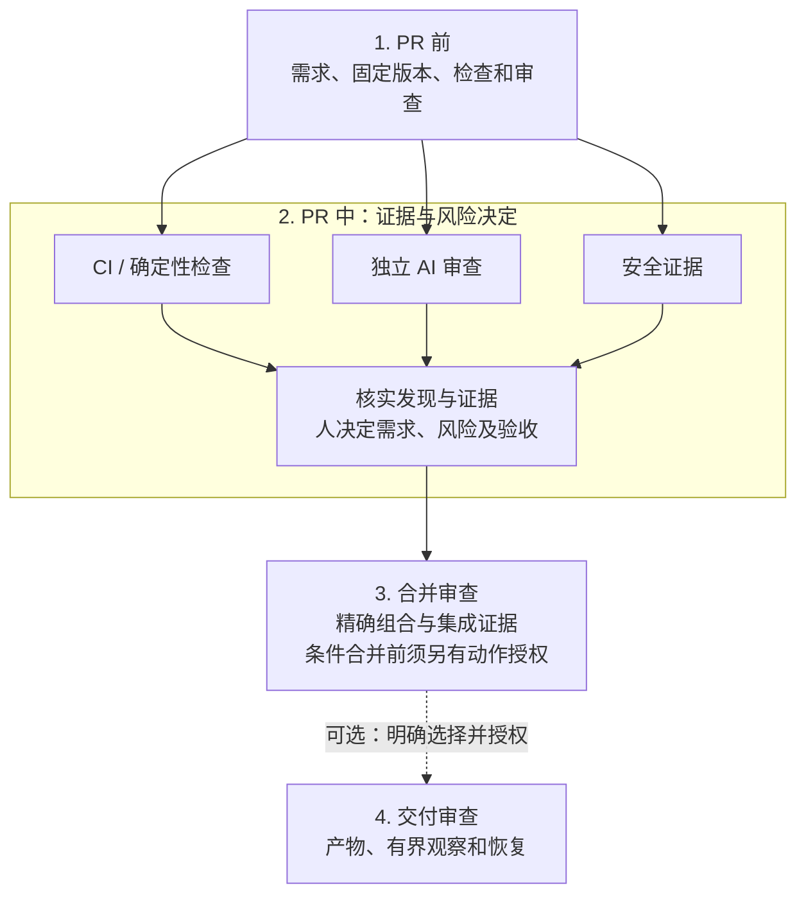

# Code-Inspection

[English](README.md) · **简体中文**

通过现有 Agent 宿主运行、不绑定模型、基于证据的代码审查 Skill。灵感来自 [How the Claude Code team does code review](https://claude.dev/blog/solving-code-review-at-anthropic/) 及日常审查经验。本项目独立、非官方，与 Anthropic 无隶属关系，也未获其背书。

**Human steer, agent execute.** 人负责需求、架构、可接受风险和验收；Agent 负责调查、验证、整理证据及获授权的修复。阶段建议不授予创建 PR、评论、合并或发布的权限。

## 开始使用

按任务选择起步路径，可以只使用一个阶段，无需跑完整生命周期。

| 路径 | 所需条件 | 第一步 |
| --- | --- | --- |
| **A. 使用 Markdown Skill 审查** | 已获准读取完整仓库及指定目标的现有 Agent 宿主；**不需要 Python 运行时** | [取得文件并开始只读审查](docs/getting-started.md#1-get-the-complete-repository)。 |
| **B. 体验本地教学示范** | 已有 Python 3.9+（优先选已测试的 3.13）、受支持的本地文件能力，以及支持 `merge-tree --write-tree` 的 Git | [运行隔离示范](docs/getting-started.md#4-optional-run-the-local-demo)，不连接模型或平台。 |
| **宿主接入：嵌入可选接口** | 受信宿主，具有明确政策、证据、授权及后端能力 | [规划接入](docs/getting-started.md#5-optional-embed-the-interfaces)，不内置生产 provider。 |

路径 A 可以先取得完整 checkout：

```sh
git clone https://github.com/zhenkun26/Code-Inspection.git
cd Code-Inspection
```

也可在仓库页面选择 **Code → Download ZIP**，完整解压。保留 `.agents/`、`skills/`、`docs/`、`interfaces/` 及其余分发文件；只复制一个入口会破坏相对引用。本仓库从去隐私化文件快照建立独立历史，不包含私人开发历史、PR 讨论或审计记录。

在现有宿主中明确要求：

> 读取 `.agents/skills/code-inspection/SKILL.md`，选择 PR 前审查。先只读评估我指定的目标、版本、原始需求、验收条件和受信政策。仅使用我提供的路径、命令、数据接收方及预算，报告实际读取、证据、发现、缺口和 READY_FOR_NEXT/HOLD/REPLAN。

填写[首次审查任务单并查看预期报告](docs/getting-started.md#3-start-your-first-read-only-review)。Codex 用户将本 checkout 作为项目打开，并显式加载仓库入口，见[宿主操作](docs/getting-started.md#2-load-a-stage-in-your-existing-host)及[设置与验收限制](docs/codex-setup.md)。其他宿主若支持读取本地文件，可按明确路径读取阶段入口。无需全局安装。本快照的自动发现/加载及取消/恢复尚未验证；详细指南和协议使用英文。

## 四个阶段



宿主支持隔离且依赖允许时，PR 检查与审查可在同一固定快照上并行。流程图描述职责，不代表已安装服务或自动执行。缺少必需证据时保持 HOLD；`READY_FOR_NEXT` 只建议进入下一阶段，**从不授予动作权限**。阶段之间保留同一任务历史和累计预算。

Git 文本合并无冲突不等于语义验收通过；解决冲突时引入的新逻辑须返回审查并复验受影响检查。

| 阶段入口 | 已实现范围 |
| --- | --- |
| [PR 前](skills/pre-pr-review/SKILL.md) | Markdown 指令与五份共享协议；真实使用验证及独立审查取决于宿主能力和权限。 |
| [PR 中](skills/pr-in-review/SKILL.md) | 证据、发现处置和真人决定；可选本地记录执行层及安全结果导入。 |
| [合并时](skills/merge-review/SKILL.md) | 真实受控裸 Git 组合与条件引用更新，仅限显式隔离的自有仓库及 merge commit。 |
| [可选交付](skills/delivery-review/SKILL.md) | 本地模拟；受信宿主 deploy/rollback 接口，不内置生产 provider。 |

## 按需继续

- [启动指南：前提、宿主加载、首次报告及常见问题](docs/getting-started.md)
- [本地示范、生成配置与示范证据](docs/local-walkthrough.md)
- [流程、信任边界和职责](docs/workflow.md)
- [生命周期 CLI 与宿主契约](interfaces/lifecycle/README.md) · [安全结果接口](interfaces/security-tools/README.md)
- [验证范围](docs/acceptance.md) · [原生 Windows 限制](docs/windows-support.md)
- [来源与许可范围](docs/sources.md)

宿主须保护政策、授权及账本状态，过滤敏感数据并执行动作权限。被审查文件和日志不能授予权限；摘要及 JSON 人名不是身份认证或沙箱。本项目不内置自动托管 CI/AI 审查服务、原生托管 CI/SARIF 导入器、生产连接器、评测数据集或评分器。宿主/模型可能收费，或向获授权 provider 传输数据；仅使用 Markdown 不保证离线。

可选接入各有契约：[产物内容](docs/artifact-content.md)、[来源清单](docs/source-manifests.md)、[构建来源](docs/build-provenance.md)、[宿主交付](docs/host-delivery.md)和[临时状态检查/恢复](docs/temporary-state.md)。缺少必需能力时保持 UNKNOWN/HOLD。模拟及接口测试不证明生产效果、健康、身份或持久性；Windows 受控临时清理尚不支持。

## 仓库检查

首次 Markdown 审查无需运行以下维护命令。它们需要 Git checkout、已有 Python/Git，以及在仓库外创建自有临时 fixture 的授权：

```sh
python3 -B validation/run_checks.py --keep-artifacts
python3 -B validation/mutation_check.py
```

Windows 上若已安装的解释器命令为 `python`，请用它替换 `python3`。[CI 矩阵](.github/workflows/ci.yml)配置为 Ubuntu 24.04/Python 3.9 和 3.13，加上符合[原生支持契约](docs/windows-support.md)的 Windows 2025 x64/Python 3.13。请核对精确版本的[实际 Actions 结果](https://github.com/zhenkun26/Code-Inspection/actions/workflows/ci.yml)。测试覆盖结构、普通/优化 Python、隔离示范、文件控制及精确摘要覆盖；固定保护条件移除仅属定向回归。结果不证明模型审查质量、扫描器效果或生产安全。超时保留部分输出，剩余检查保持 NOT_RUN，不保证所有后代进程均已终止，见[验收限制](docs/acceptance.md)。有意变更分发文件后，应为除清单自身外的所有选中文件更新 `SHA256SUMS`。

## 帮助、贡献与安全

请通过 [Issues](https://github.com/zhenkun26/Code-Inspection/issues) 提交去敏问题及可复现的非敏感缺陷。先阅读[贡献指南](CONTRIBUTING.md)及[安全政策](SECURITY.md)。不假定已配置私密报告渠道或响应时限。公开报告中不要放入凭据、私人代码、个人路径或原始宿主对话。

## 许可

所有者有权许可的原创项目内容采用 [MIT License](LICENSE)，Copyright (c) 2026 Zhenkun。第三方文章、翻译、图片及私人输入不在许可范围内，不重新授权；未捆绑第三方运行时，参考来源及将来复制义务见[来源说明](docs/sources.md)。
