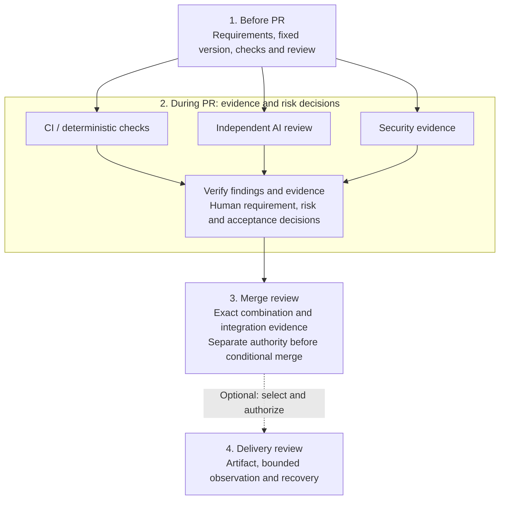

# Code-Inspection

**English** · [Chinese](README-zh.md)

A model-agnostic, evidence-based code-review Skill for your existing agent host. Inspired by [How the Claude Code team does code review](https://claude.dev/blog/solving-code-review-at-anthropic/) and everyday review practice. Independent and unofficial; not affiliated with or endorsed by Anthropic.

**Human steer, agent execute.** Humans decide requirements, architecture, acceptable risk and acceptance. Agents investigate, validate, organize evidence and perform authorized repairs. A stage recommendation never grants permission to create a PR, comment, merge or release.

## Start

Choose the smallest path that serves your task. You can use one stage without running the whole lifecycle.

| Path | What you need | First step |
| --- | --- | --- |
| **A. Review with the Markdown Skills** | An existing agent host allowed to read the complete repository and your selected target; **no Python runtime required** | [Get the files and start a read-only review](docs/getting-started.md#1-get-the-complete-repository). |
| **B. Try the local teaching example** | Existing Python 3.9+ (prefer tested 3.13), supported local file operations and Git with `merge-tree --write-tree` | [Run the isolated demo](docs/getting-started.md#4-optional-run-the-local-demo). No model or platform connection. |
| **Host integration: embed optional interfaces** | A trusted host with explicit policy, evidence, authority and backend capabilities | [Plan the integration](docs/getting-started.md#5-optional-embed-the-interfaces). No bundled production provider. |

For path A, get the full checkout:

```sh
git clone https://github.com/zhenkun26/Code-Inspection.git
cd Code-Inspection
```

Or use the repository's **Code → Download ZIP** and extract the complete folder. Keep `.agents/`, `skills/`, `docs/`, `interfaces/` and the rest of the distribution together; copying a single entry breaks relative references. This repository starts from a sanitized file-only snapshot; private development history, PR discussions and audit records are excluded.

In your existing host, explicitly ask:

> Read `.agents/skills/code-inspection/SKILL.md` and select pre-pr review. Start with a read-only assessment of my specified target, version, original requirements, acceptance criteria and trusted policy. Use only the paths, commands, data recipients and budget I supply. Report actual reads, evidence, findings, gaps and READY_FOR_NEXT/HOLD/REPLAN.

Fill in the [first-review task brief and expected report](docs/getting-started.md#3-start-your-first-read-only-review). For Codex, open this checkout as the project and explicitly load the repo entry; see [host steps](docs/getting-started.md#2-load-a-stage-in-your-existing-host) and [setup/acceptance limits](docs/codex-setup.md). Other hosts can read a stage by explicit path if they support local files. No global installation is required. Automatic discovery/loading and cancellation/resumption remain unverified for this snapshot. Detailed guides and protocols are in English.

## Four stages



PR checks and reviews may run in parallel on the same fixed snapshot when the host supports isolation and dependencies allow it. The diagram describes responsibilities, not installed services or automatic execution. Missing required evidence stays HOLD; `READY_FOR_NEXT` recommends the next stage and **never authorizes an action**. Each stage keeps the same task history and cumulative budget.

A clean textual Git merge does not establish semantic acceptance. New logic introduced while resolving conflicts returns to review and affected checks.

| Stage entry | Implemented scope |
| --- | --- |
| [Before PR](skills/pre-pr-review/SKILL.md) | Markdown instructions and five shared protocols; real-use verification and independent review depend on host capabilities and permission. |
| [During PR](skills/pr-in-review/SKILL.md) | Evidence, finding dispositions and human decisions; optional local record runner and security-result import. |
| [At merge](skills/merge-review/SKILL.md) | Real controlled bare-Git combination and conditional ref update, limited to explicitly isolated self-owned repositories and merge commits. |
| [Optional delivery](skills/delivery-review/SKILL.md) | Local simulation; trusted-host deploy/rollback interface with no bundled production provider. |

## Continue when needed

- [Getting started: prerequisites, host loading, first report and FAQ](docs/getting-started.md)
- [Local walkthrough, generated configuration and demo evidence](docs/local-walkthrough.md)
- [Workflow, trust boundaries and responsibilities](docs/workflow.md)
- [Lifecycle CLI and host contract](interfaces/lifecycle/README.md) · [Security-result interface](interfaces/security-tools/README.md)
- [Verification scope](docs/acceptance.md) · [Native Windows limits](docs/windows-support.md)
- [Sources and license scope](docs/sources.md)

The host must protect policy, authority and ledger state, filter sensitive data and enforce permitted actions. Reviewed files and logs cannot grant permissions; hashes and JSON actor names are not authentication or a sandbox. No automatic hosted CI/AI-review service, native hosted-CI/SARIF importer, production connector, evaluation dataset or scorer is included. Host/model use may incur costs or transfer data to authorized providers; Markdown-only use does not guarantee offline operation.

Optional integrations have separate contracts: [artifact content](docs/artifact-content.md), [source manifests](docs/source-manifests.md), [build provenance](docs/build-provenance.md), [host delivery](docs/host-delivery.md) and [temporary-state inspection/recovery](docs/temporary-state.md). Missing required capability stays UNKNOWN/HOLD. Simulations and interface tests do not establish production effect, health, identity or durability; Windows managed temporary cleanup is unsupported.

## Repository checks

These maintainer commands are optional for a first Markdown review. They require a Git checkout, existing Python/Git and authorization to create disposable self-owned fixtures outside it:

```sh
python3 -B validation/run_checks.py --keep-artifacts
python3 -B validation/mutation_check.py
```

On Windows, use `python` if that is your installed interpreter command. The configured [CI matrix](.github/workflows/ci.yml) is Ubuntu 24.04/Python 3.9 and 3.13, plus Windows 2025 x64/Python 3.13 under its [native support contract](docs/windows-support.md). Check the [actual Actions result](https://github.com/zhenkun26/Code-Inspection/actions/workflows/ci.yml) for your exact revision. Tests cover structure, ordinary/optimized Python, isolated demos, file controls and exact checksum coverage; fixed guard-removal checks are targeted regressions. Results do not prove model-review quality, scanner effectiveness or production safety. Timeouts retain partial output and remaining NOT_RUN checks; descendant termination is not guaranteed. See [acceptance limits](docs/acceptance.md). After intentional distribution changes, update `SHA256SUMS` for every selected file except itself.

## Help, contributions and security

Use [Issues](https://github.com/zhenkun26/Code-Inspection/issues) for sanitized questions and reproducible non-sensitive bugs. Read [contribution guidance](CONTRIBUTING.md) and [the security policy](SECURITY.md). A private reporting channel and response-time commitment are not assumed. Keep credentials, private code, personal paths and raw host transcripts out of public reports.

## License

Original project content that the owner has the right to license is available under the [MIT License](LICENSE), Copyright (c) 2026 Zhenkun. Third-party articles, translations, images and private inputs are excluded and are not relicensed. No third-party runtime is vendored; references and future copying obligations are recorded in [sources](docs/sources.md).
